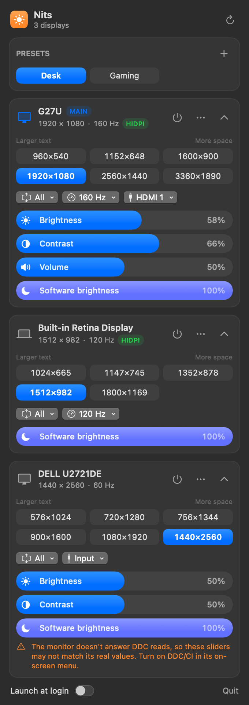
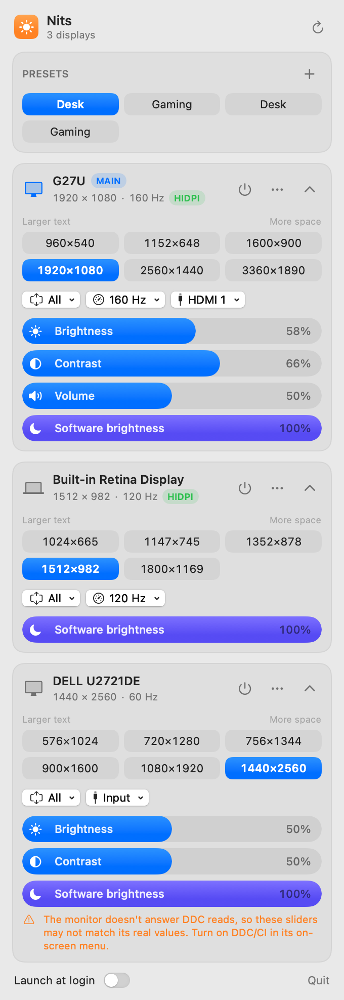

# Nits

A small, free menu bar app for managing displays on Apple Silicon Macs: sharp HiDPI modes on
non-Retina monitors, monitor brightness and input over DDC, one-click display presets, and turning
screens off without unplugging them.

<p align="center">
  
  &nbsp;
  
</p>

## Features

- **One-click resolutions.** Up to six "looks like" sizes per display, from larger text to more space,
  plus every mode the display offers. A 15-second *Keep this resolution?* countdown reverts any change
  you don't confirm, so a bad mode can't leave you on a black screen.
- **HiDPI on non-Retina monitors.** Installs a display override so macOS offers sharp 2× modes (for
  example "looks like 1920×1080" on a 1440p panel). The modes are real modes of the monitor and keep
  working when Nits isn't running.
- **Monitor controls over DDC/CI.** Brightness, contrast, volume and input switching for external
  monitors, plus software dimming (gamma) for any display.
- **Presets.** Save the whole desk (resolution, refresh rate, rotation, arrangement, which screens are
  on, brightness) and switch back in one click, with one revert countdown for the whole change.
- **Turn a display off** without unplugging it, such as the MacBook's built-in screen. Nits never turns
  off the last active display, asks you to confirm (doing nothing turns it back on), and turns
  everything back on when it quits.
- **Remembers resolutions.** When a monitor is unplugged and plugged back in (or another screen comes
  or goes), macOS often switches to a default resolution. Nits restores the one you were using.
- **Arrangement repair.** Detects screens that touch only at a corner (the cursor can't cross) and moves
  them the shortest distance to share an edge.
- Refresh rate, rotation, main display, launch at login.

## Requirements

- macOS 14 Sonoma or later
- Apple Silicon (DDC uses the Apple Silicon display service; other features may work on Intel but are untested)

## Build and install

```bash
swift test                     # unit tests (Swift Testing, no hardware needed)
./scripts/bundle.sh            # build/Nits.app (ad-hoc signed)
./scripts/bundle.sh --install  # also copy to ~/Applications
```

Nits is built from source for now. An ad-hoc signed app shows a Gatekeeper warning the first time you
open it if you copy it to another Mac.

### Command-line helpers

```bash
Nits.app/Contents/MacOS/Nits --dump                    # print what Nits detects; changes nothing
Nits.app/Contents/MacOS/Nits --snapshot out.png dark   # render the menu to a PNG
```

## Security and safety

Nits asks for your admin password **only** to install or remove a HiDPI override. Everything else runs
as your user.

What runs as root, and how it's constrained:

- The only file written is
  `/Library/Displays/Contents/Resources/Overrides/DisplayVendorID-<hex>/DisplayProductID-<hex>`.
  The path must match a strict pattern before the password prompt appears.
- The plist is sent inside the command (base64), not through a temporary file another process could
  swap. Root writes it into the root-owned destination folder, checks it with `plutil -lint`, and
  renames it into place.
- The command refuses to write through symbolic links and must pass a character allowlist (no
  variables, command substitution or double quotes).
- Before replacing or removing an override, Nits copies the old one to
  `~/Library/Application Support/Nits/Backups`.

Other safety measures:

- Resolution, rotation, preset and turn-off changes show a 15-second **Keep / Revert** countdown.
  Doing nothing reverts, and only one such change can be pending at a time.
- Turning a display off lasts for the session only. Nits turns all displays back on when it quits,
  including when it's stopped with `kill`, and rediscovers turned-off displays after a crash.
- Software dimming scales the display's own gamma table (keeping any calibration) and is reset when
  Nits quits.
- DDC replies are checksum-verified and every value sent to a monitor is range-checked.

Nits has no network access, collects nothing, and stores its settings in its own preferences
(`com.edhem.nits`).

## Private APIs

Some features use undocumented macOS interfaces. They're looked up while the app runs, so if a macOS
update removes one, that feature disappears instead of the app crashing.

| Feature | Interface |
| --- | --- |
| DDC/CI | `IOAVServiceCreateWithService`, `IOAVServiceReadI2C`, `IOAVServiceWriteI2C` (IOKit) |
| Turn a display off | `SLSConfigureDisplayEnabled` (SkyLight) |
| Rotation | `MPDisplay` (MonitorPanel), run in a short-lived helper process |

MonitorPanel builds a large mode table when it loads (seconds of work and hundreds of MB on a 4K
high-refresh monitor) and redoes it on every display change, so the menu bar app never loads it: each
rotation runs `Nits --rotate <display> <degrees>` as a separate process that exits afterwards.

These can break in any macOS release. Nits can't be distributed through the Mac App Store because of
them.

## Troubleshooting

- **Brightness sliders don't change the monitor:** turn on DDC/CI in the monitor's on-screen menu. Some
  USB-C hubs and docks don't pass DDC through; try a direct cable.
- **New HiDPI modes don't appear:** unplug and replug the monitor, or log out and back in.
- **Two display managers at once:** don't let Nits and another display app manage the same display;
  quit one of them.

## Logs

Nits writes to the unified log. To see what it did around a display change:

```bash
/usr/bin/log show --last 30m --info --predicate 'subsystem == "com.edhem.nits"'
```

(Use the full path in zsh, where `log` is a shell built-in.)

## Acknowledgements

The Apple Silicon DDC approach (I²C through `IOAVService`) was documented by the open-source community,
notably the MonitorControl and m1ddc projects.

## License

[MIT](LICENSE)
